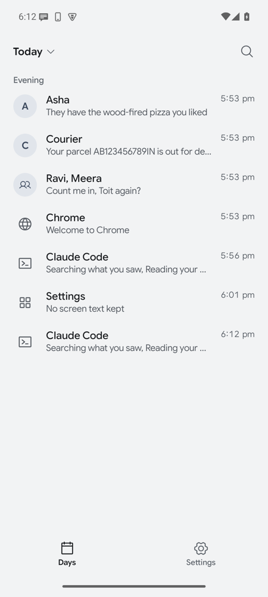
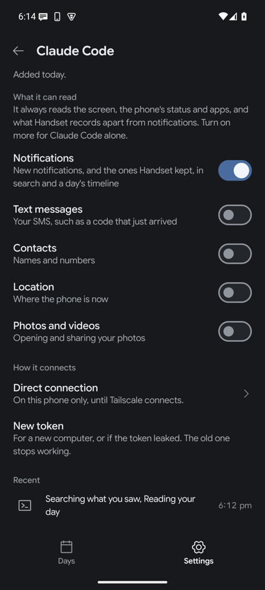
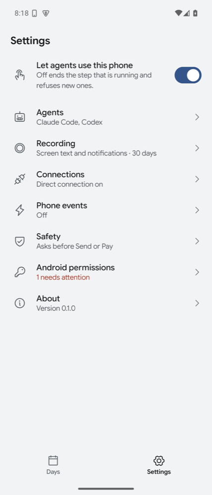

# Handset

Handset is an Android app that gives your AI agents your phone. Claude, ChatGPT, Claude Code, Codex or any other MCP client can read the screen, open apps, tap, type and scroll, the way you would. It can also keep a private record of what you did on the phone each day, which you browse in the app and your agents can search.

Everything stays on the phone unless you connect an agent. Each agent gets its own switches for what it may read. A tap on Send or Pay waits for your tap. Stop ends anything. The app is open source under the MIT license.

You install it from a file, not from Play. It drives the phone through an accessibility service, and Play allows those only in apps for people with disabilities.

<p>



</p>

## Install and turn it on

You need a phone on Android 11 or newer. On the phone, download [handset.apk](https://github.com/triptu/handset/releases/latest/download/handset.apk), the newest release, and open it to install. Each [release](https://github.com/triptu/handset/releases) lists the APK's SHA-256 and its signing certificate, so you can check what you install. A newer APK installs over the old one and keeps your settings. You can also [build it from source](#build-from-source).

Open the app. Its setup screen walks through three Android settings:

- **Accessibility** lets agents read the screen and act on it.
- **Notification access** lets them read and reply to notifications and control what's playing.
- **Unrestricted battery** keeps the phone reachable while the screen is off.

Android greys out the Accessibility switch for an app installed from a file. Try to turn it on once, then open the app's App info, tap ⋮ and choose Allow restricted settings, and turn it on again.

Setup also offers contacts, text messages, location, photos and videos, and screen time. Each one is off until you turn it on, and each has a switch in Settings, Android permissions. A tool that needs one that is off tells the agent so.

## Connect an agent

Agents reach the phone one of two ways. Both are off until you turn them on.

To stop one agent for a while without removing it, turn off the switch at the top of its page under Settings, Agents. Its calls are refused until you turn it on again, and it keeps its token or sign-in and its switches. Connecting an app again, or signing in again from the same relay client, turns a paused agent back on.

### Through a relay, for claude.ai and ChatGPT

The relay is a small Cloudflare Worker you deploy yourself. It gives your phone a public HTTPS address. The phone connects out to it, so it needs no public IP or open port. The [relay guide](relay/README.md) covers deploying it in three commands and adding it to Claude or ChatGPT.

1. In Handset, open Settings, Connections. Paste your relay's address under **Relay** and tap **Connect**. The row shows whether it is connected and your phone's public MCP address.
2. Add that address as a custom connector in claude.ai or as a custom MCP app in ChatGPT. On the relay's sign-in page, enter the phone ID Handset shows.
3. The phone shows a notification with the site that asked, the client's name and a six-digit code. Allow only if you started the sign-in on that site and the code matches the browser.

The approved agent appears under Settings, Agents, with every switch off. Turn on only what it needs. Removing it there revokes its grant. **Disconnect the relay** removes every agent that signed in through it.

A Claude connector works in the Claude apps under the same account, and in Claude routines. The phone must be online when the agent calls it.

### Directly, for agents on your own computer

Claude Code, Codex, Claude Desktop and other MCP clients connect over Tailscale, or over your Wi-Fi when you allow it, with nothing in between.

1. In Handset, open Settings, Agents, and tap **Add agent**. Name it after the app it runs in.
2. Handset shows the agent's token once, inside a ready setup for Claude Code, Codex, Claude Desktop or any MCP client. Copy yours and paste it where the agent runs.

The phone listens on port 8765. Settings, Connections shows its Tailscale address when Tailscale is on, and its Wi-Fi address when you turn on **Also on Wi-Fi**. The setups look like this:

```bash
# Claude Code
claude mcp add --transport http handset http://100.101.102.103:8765/mcp --header "Authorization: Bearer hs_..."

# Codex
export HANDSET_TOKEN=hs_...
codex mcp add handset --url http://100.101.102.103:8765/mcp --bearer-token-env-var HANDSET_TOKEN
```

Any MCP client needs that URL and the header `Authorization: Bearer <token>`. The traffic is plain HTTP, which Tailscale encrypts. On Wi-Fi anyone on the network could read it, so turn on **Also on Wi-Fi** only on a network you trust. **New token** on the agent's page replaces its token. **Remove** revokes it. The phone keeps only a hash of each token.

To try it from a computer over USB, forward the port with `adb forward tcp:8765 tcp:8765` and use `127.0.0.1` as the address.

### From another app on this phone

An app on the same phone, such as an on-device chat app, can connect as an agent with one tap. Nobody copies a token.

1. The app starts the action `ai.tushar.handset.action.CONNECT_APP` for a result, with `ActivityResultContracts.StartActivityForResult` or `startActivityForResult`. A plain `startActivity` is refused, since Handset must know which app is asking. On Android 11 and later, add `<queries><package android:name="ai.tushar.handset" /></queries>` to the app's manifest.
2. Handset shows "<App> wants to use this phone" with the app's name, icon and package, and the same switches as any agent's page, all off. The user taps **Allow** or **Don't allow**.
3. On Allow, Handset turns on its MCP server on the phone itself (not on Wi-Fi), waits until its own socket holds `127.0.0.1:8765`, and returns `RESULT_OK` with these String extras:
   - `mcp_url`: `http://127.0.0.1:8765/mcp`
   - `token`: the app's bearer token, sent as `Authorization: Bearer <token>`
   - `agent_id`: the agent's id in Handset
4. Otherwise it returns `RESULT_CANCELED` with `reason`: `denied` (the user said no or went back), `not_for_result`, `handset_off` (agents are switched off in Handset), or `port_in_use` (another app holds port 8765 on the phone, so Handset gave no token).

Handset knows the app by its package name and the SHA-256 of its signing certificate. Connecting again from the same app gives it a new token, keeps its switches and turns it on if it was paused, so it can ask again whenever it lost its token. The same package signed with another key is a different agent. Uninstalling the app removes its agent, and its token stops working. The token works only at `127.0.0.1` on the phone itself, never over Wi-Fi, Tailscale or a relay.

The app shows under Settings, Agents as "On this phone". Its calls go through every check other agents' calls do: its switches, Send and Pay approval, Stop, the activity record, and Handset's private screens.

## What agents can do

Every agent can read the screen, the phone's status, the app list and screen time, and act on the screen. Notifications, text messages, contacts, location, and photos and videos are off for each agent until you turn them on on its page under Settings, Agents. Agents can't open or read Handset's own screens.

| Tools | What they do |
|---|---|
| `get_screen`, `read_text`, `wait_for`, `screenshot` | Read the app in front and its elements, each with an id and a position. Wait for text or an app to appear. |
| `tap`, `type_text`, `scroll`, `swipe`, `set_value`, `press` | Act on an element by id or text, or on a point, and return the settled screen. |
| `run_steps` | Up to 20 actions in one call. It stops at the first one that fails. |
| `open_app`, `list_apps`, `open_url`, `web_search` | Open apps, links and searches. |
| `set_alarm`, `set_timer`, `set_volume`, `set_do_not_disturb`, `device_status`, `screen_time` | System settings and status, with no screen needed. |
| `list_notifications`, `reply_notification`, `now_playing`, `inbox_since` | Read and reply to notifications, control what's playing, and catch up on what came in since a time. |
| `read_sms`, `find_contact`, `get_location`, `list_media`, `view_media`, `share_media` | Your own things, each behind its switch. |
| `search_context`, `day_timeline` | Search the day record, and read one day's apps, places, notifications and agent steps in order. |

Screen actions run one at a time, in the order they arrive, so the actions an agent sends in one turn don't race. Each action waits for the screen to settle before it answers, and says whether anything changed. The rest run as soon as they arrive. A call has 2 minutes by default. [docs/development.md](docs/development.md) describes how a call settles and how to try tools over adb.

### What you see

While an agent works, a pill at the top of the screen says who is doing what, such as "Claude Code is opening Clock", with Stop. Each tap shows as a ring and each swipe as a moving dot. Stop ends the running call and the waiting ones, and refuses new ones until you turn agents on again.

With **Ask me before tapping Send or Pay** on, a tap on an element labelled Send, Pay, Buy, Order, Transfer, Post or Publish waits for you to tap Allow in a notification. While it waits, other screen calls wait too, so the agent can't tap Allow itself.

Every step an agent takes, refused and stopped ones included, is kept in the day record and shows in Days.

## The day record

Under Settings, Recording, four sources each have a switch, all off at first:

- **Screen text**, the text of the screens you open, for search.
- **Notifications** as they arrive, for catching up.
- **App use**, which app was open and when.
- **Places**, where you stayed 10 minutes or more. Tap a place in Days to name it.

The Days tab shows each day by time. Open a moment to read the screens you saw, a conversation, or an agent's steps, and search everything kept. **Pause for an hour** stops recording, from Settings or a quick settings tile. **Delete today** removes everything since midnight. Password managers, payment apps, keyboards and the apps you add under **Apps never read** are never recorded.

## Privacy

- **What is stored.** The day record and every agent's steps, in a database in the app's private storage on the phone. Screen text and notifications are kept 7, 30 or 90 days, as you choose. App use, places, agent steps and phone events are kept a year.
- **What leaves the phone.** A tool's result goes to the agent that called it. Phone events go to the one address you gave. Nothing else is sent, and the day record is never uploaded.
- **Who is in between.** A direct connection has nobody. A relay connection passes through Cloudflare and your relay, which can read calls in transit, and the AI provider receives the results. The relay stores sign-in records, never call content. The [relay guide](relay/README.md#privacy) has the detail.
- **What each agent sees.** Only the sources you turned on for it. Search and the day's timeline leave out what it can't read. Another agent's steps show only the tool and whether it worked.

## Phone events

Handset can tell a Claude routine, or any address that takes a POST, when something happens on the phone. The routine decides what to do, and can call the phone back through the Handset connector. Under Settings, Phone events, each event has its own switch:

- **Battery below a level**, 20% unless you pick another, once each time it runs down.
- **Charging started or stopped.**
- **Arrived at or left a place** you named in Days, while Places is recording.
- **A notification from someone**, from the people and apps you pick.

An event carries only an id, its type, the time, and the battery level, place name, or the person's or app's name. It never carries what a message says. Every event, sent or not, shows in Days with exactly what was sent. The address and its token are kept encrypted with a key in Android's keystore. Handset posts at most 20 times an hour, tries included. A failed post is tried again, up to 5 times, so a routine can get an event twice. Every try carries the same `event_id`.

To start a Claude routine from the phone:

1. At [claude.ai/code/routines](https://claude.ai/code/routines), make a routine with the Handset connector and any others it needs. Write a prompt that reads the event, skips an `event_id` it has seen, and acts on the type.
2. Add an **API** trigger. Copy its fire URL and generate a token.
3. In Handset, tap **Send events to a routine**, paste both, and tap **Save**. Handset recognises a Claude routine and adds the header it needs.
4. Tap **Send a test event**. The routine's history shows a new run.

A Claude routine gets the event as text, a sentence and the fields as JSON. Any other address gets the fields alone, with `Authorization: Bearer <token>` when you gave one:

```json
{"event_id":"evt_8b21e0c5f7a34d9612ce57b0","type":"arrived","time":"2026-10-27T09:12:40+05:30","place":"Office"}
```

The types are `battery_low`, `charging_started`, `charging_stopped`, `arrived`, `left`, `notification` and `test`. Battery and charging changes are heard only while Handset's process runs. After Android restarts it, the first reading is compared with the last one kept, so a change in between still sends one event.

## Build from source

You need JDK 17 and the Android SDK. From `android/`:

```bash
./gradlew :app:assembleRelease
adb install -r app/build/outputs/apk/release/app-release.apk
```

A release build signs with the key in `~/.config/handset/` when that folder exists, or with the `HANDSET_KEYSTORE` and `HANDSET_KEYSTORE_PASSWORD` variables, and with the debug key otherwise. Android refuses an update signed with a different key, so uninstall first when you switch keys. The version code is the minutes since the start of 2026, so a newer build always installs over an older one.

[docs/development.md](docs/development.md) covers trying tools over adb, turning the Android switches on from a computer, and recording screens for the screen reader's tests.
