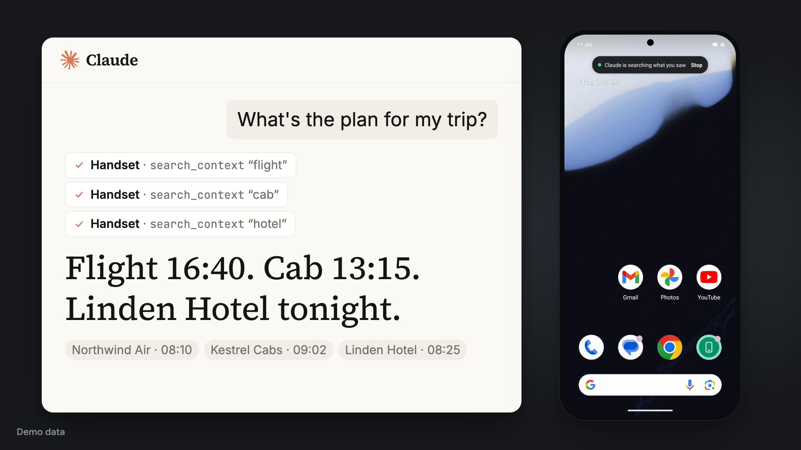
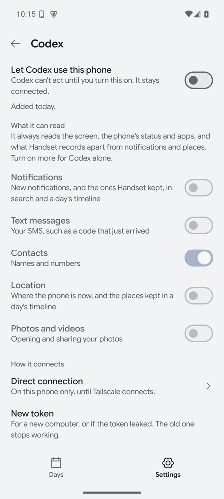
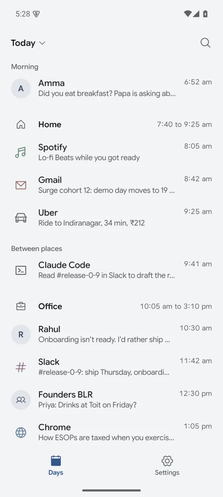
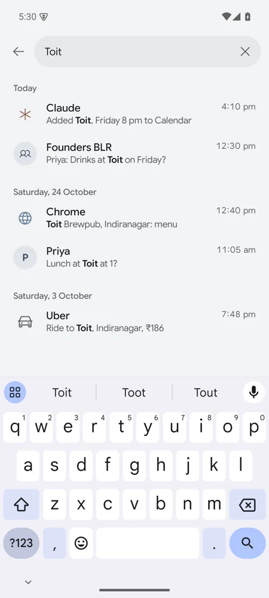

# Handset

Handset gives your AI agents your phone. Claude, ChatGPT, Claude Code, Codex or any other MCP client can read the screen, open apps, tap, type and scroll, the way you would.

<a href="https://github.com/triptu/handset/blob/main/site/public/media/trailer.mp4"></a>

[Watch the trailer](https://github.com/triptu/handset/blob/main/site/public/media/trailer.mp4) (59 s) · [handset.tushar.ai](https://handset.tushar.ai)

## It uses the apps you already have

An agent reads the app in front, then taps, types, scrolls and swipes. While it works, a pill at the top of the screen says who is doing what, with Stop.

## You choose what each agent can do



Every agent can read the screen and act on it. Notifications, text messages, contacts, location and photos are off for each agent until you turn them on. With **Ask me before tapping Send or Pay** on, Handset asks you before tapping a button it recognises as Send, Pay or similar. Pause an agent to stop it for a while, or remove it.

## A private record of your day

<p>


</p>

If you want it, Handset keeps what you saw on screen, your notifications, the apps you used and where you stayed. Each source is off until you turn it on. The Days tab shows each day by time, and you and your agents can search it. Screen text and notifications from password managers, payment apps, keyboards and the apps you add to the list are never kept.

## The phone can start a routine

Handset can tell a Claude routine, or an address you give, when the battery runs low, charging starts or stops, you arrive at or leave a place, or someone you picked sends a notification. It never sends what a message says.

## Privacy

The record and every agent's steps stay on the phone. An agent you connect gets the results it asks for, such as the screen or a search of the record. Phone events you turn on go to the address you chose. A connection through a relay for claude.ai or ChatGPT passes through Cloudflare and your own relay.

## Install and connect

You need a phone on Android 11 or newer. Download [handset.apk](https://github.com/triptu/handset/releases/latest/download/handset.apk) on the phone and open it to install. Handset isn't on Play.

The app's setup turns on three Android settings. Android greys out Accessibility for an app installed from a file. Try once, then open the app's App info, tap ⋮, choose **Allow restricted settings**, and turn it on again.

Then give your coding agent this prompt:

```
Set up https://github.com/triptu/handset so you can use my Android phone. Follow docs/setup.md in that repo.
```

Claude Code, Codex and Claude Desktop connect from your computer. For claude.ai and ChatGPT, the agent sets up a small relay in your Cloudflare account. An app on the same phone, such as [Nano Chat](https://github.com/triptu/nano-chat), connects with one tap in Handset. To add another agent or send phone events to a routine, ask the agent again.
