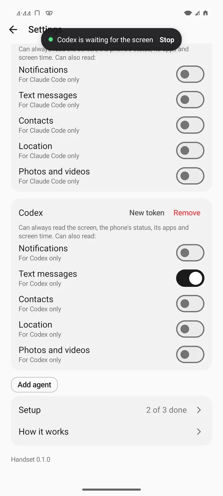
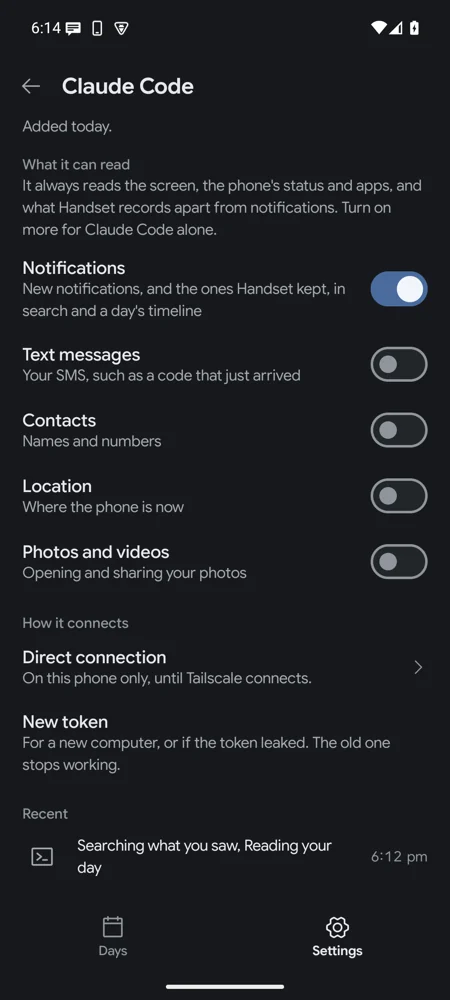
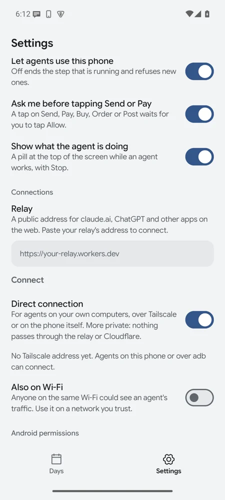
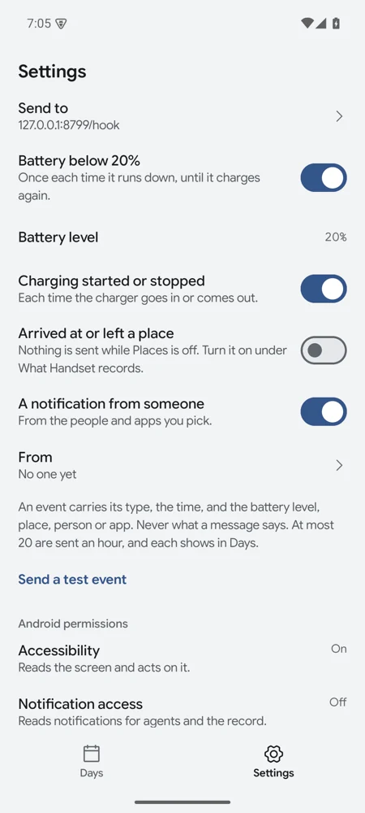
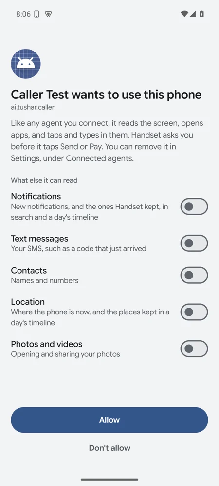

# Handset

Handset gives your AI agents your phone. Claude, ChatGPT, Claude Code, Codex or any other MCP client can read the screen, open apps, tap, type and scroll, the way you would.

<a href="https://github.com/triptu/handset/blob/main/site/public/media/trailer.mp4"></a>

[Watch the trailer](https://github.com/triptu/handset/blob/main/site/public/media/trailer.mp4) (59 s) · [handset.tushar.ai](https://handset.tushar.ai)

Nothing leaves the phone until you connect an agent. Each agent gets its own switches for what it may read, a tap on Send or Pay waits for your tap, and Stop ends anything.

## It uses the apps you already have



An agent reads the app in front, then taps, types, scrolls and swipes. It opens apps, links and searches, and sets alarms, timers, volume and Do not disturb without touching the screen. While it works, a pill at the top of the screen says who is doing what, such as "Claude Code is opening Clock", with Stop.

## You choose what each agent reads



Every agent can read the screen, the phone's status and apps, and what Handset records apart from notifications. Notifications, text messages, contacts, location, and photos and videos are off for each agent until you turn them on. Pause an agent to stop it for a while, and remove it to revoke its access. Agents can't open or read Handset's own screens.

## Send and Pay wait for you



With **Ask me before tapping Send or Pay** on, a tap on Send, Pay, Buy, Order, Transfer, Post or Publish waits until you tap Allow in a notification. Other screen actions wait with it, so the agent can't tap Allow itself. Every step an agent takes, refused and stopped ones included, shows in Days.

## A private record of your day

<p>


</p>

If you want it, Handset keeps what you saw on screen, your notifications, the apps you used and where you stayed. Every source is off at first. The Days tab shows each day by time. You can search it, and so can the agents you allow. Password managers, payment apps and keyboards are never recorded. Settings has Pause for an hour and Delete today.

## The phone can start a routine



Handset can tell a Claude routine, or any address that takes a POST, when the battery runs low, charging starts or stops, you arrive at or leave a place, or someone you picked sends a notification. It never sends what a message says.

## Apps on the phone can connect too



An app on the same phone connects as an agent with one tap, and nobody copies a token. [Nano Chat](https://github.com/triptu/nano-chat), a chat app whose models run on the phone, connects this way.

## Install it

You need a phone on Android 11 or newer. On the phone, download [handset.apk](https://github.com/triptu/handset/releases/latest/download/handset.apk) and open it to install. Each [release](https://github.com/triptu/handset/releases) lists the APK's SHA-256 and signing certificate. A newer APK installs over the old one and keeps your settings.

Open the app. Its setup walks you through three Android settings: Accessibility, Notification access and Battery unrestricted. Android greys out Accessibility for an app installed from a file. Try once, then open the app's App info, tap ⋮, choose **Allow restricted settings**, and turn it on again.

Handset isn't on Play. It drives the phone through an accessibility service, and Play allows those only in apps for people with disabilities.

## Connect an agent

Give your coding agent this prompt. It reads the repo's [guide](docs/setup.md) and does the rest. Claude Code, Codex and Claude Desktop connect from your computer. For claude.ai and ChatGPT, the agent deploys a small relay to your own Cloudflare account.

```
Set up https://github.com/triptu/handset so you can use my Android phone. Follow docs/setup.md in that repo.
```

An agent on your computer gets a token you copy from Handset. For claude.ai, ChatGPT and apps on the phone, the phone asks you to allow the sign-in first. To add another agent, move to a new computer, or send phone events to a Claude routine, ask the agent again.

## Privacy

The day record and every agent's steps live in the app's private storage on the phone and are never uploaded. A tool's result goes only to the agent that called it, and phone events go only to the one address you gave. A direct connection has nobody in between. A relay connection passes through Cloudflare and your own relay, which can read calls in transit, and the AI provider receives the results.

## Credits

The app bundles Google Sans Flex and Phosphor Icons, with their licences in [android/app/src/main/assets/licenses](android/app/src/main/assets/licenses).
